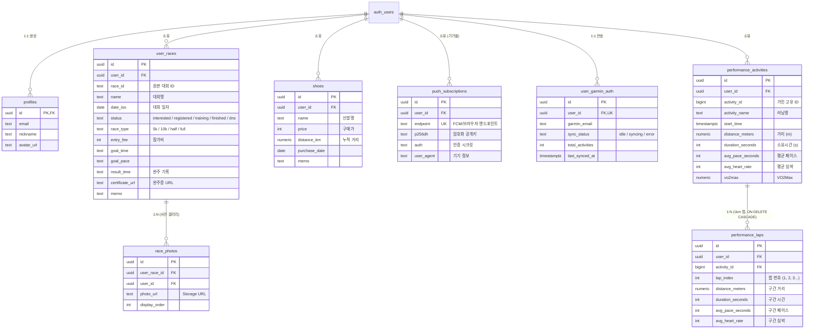

# 🏃 RACEBOOK (마라톤 일정 & 러닝 퍼포먼스 아카이브 PWA)

> **전국 마라톤 대회 실시간 수집 + 접수/D-Day 스마트 푸시 알림 + 가민(Garmin) 1km 랩 퍼포먼스 분석 + 개인 일정·완주 기록·사진 갤러리·러닝화 수명 관리 올인원 PWA**  
> 모놀리식 구조를 탈피하여 **도메인별 7대 커스텀 훅(Custom Hooks)**과 **Supabase BaaS(Auth + DB + Storage)**, **W3C Web Push 백그라운드 엔진**, **가민 커넥트(Garmin Connect) 세션 캐싱 및 1:N FK 무결성 파이프라인**, **엔지니어링 하네스(Zod 데이터 안전망 + GitHub Actions 5대 자동화)** 체계로 구축되었습니다.

[](https://github.com/yongseok1991/maration-schedule/actions)
[](https://github.com/yongseok1991/maration-schedule/actions)
[](https://github.com/yongseok1991/maration-schedule/actions)
[](#-엔지니어링-하네스-engineering-harness)
[](LICENSE)

---

## 🏛️ 시스템 아키텍처 (System Architecture)

RACEBOOK은 클라이언트 독립적인 반응형 PWA 프론트엔드와 고성능 Supabase 클라우드 BaaS, 그리고 자동화된 백그라운드 데이터 수집/발송 파이프라인이 유기적으로 결합된 4계층 아키텍처로 설계되었습니다.

```mermaid
flowchart TD
    subgraph Client["1. PWA 클라이언트 (React 19 + Vite + Tailwind)"]
        UI["UI Layer (Browse / Mine / Calendar / MyPage / Performance)"]
        
        subgraph Hooks["7대 도메인별 Custom Hooks Layer"]
            HAuth["useAuth (세션/로그인)"]
            HRaces["useRaces (대회/전체검색)"]
            HEntries["useEntries (일정/⭐찜/갤러리)"]
            HShoes["useShoes (러닝화 관리)"]
            HStats["useStats (PB/지출 통계)"]
            HPerf["usePerformance (가민 분석)"]
            HPush["useWebPush (스마트 알림)"]
        end

        subgraph Worker["Service Worker (Workbox + custom-sw)"]
            SWCache["오프라인 정적 에셋 캐싱"]
            SWPush["Push / NotificationClick 리스너"]
        end
    end

    subgraph Backend["2. Supabase Cloud BaaS (PostgreSQL + Auth + Storage)"]
        SAuth["Supabase Auth (이메일/소셜 로그인)"]
        
        subgraph Database["PostgreSQL (RLS 본인 데이터 완벽 격리)"]
            TProfiles[("profiles (사용자 정보)")]
            TRaces[("user_races (일정 & ⭐찜)")]
            TPhotos[("race_photos (갤러리 6장)")]
            TShoes[("shoes (신발 수명/누적거리)")]
            TPush[("push_subscriptions (기기 토큰)")]
            TGarminAuth[("user_garmin_auth (연동 상태)")]
            TAct[("performance_activities (부모, 러닝 활동)")]
            TLaps[("performance_laps (자식, 1km 랩)")]
        end

        SStorage["Supabase Storage (CDN 이미지)
        • certificates (완주증)
        • race-photos (대회 현장 사진)"]
    end

    subgraph External["3. 외부 연동 & 서드파티 엔진 (External Integration)"]
        GarminAPI["Garmin Connect API (글로벌 153개국)"]
        WebPushGateway["FCM / APNs (W3C Web Push 프로토콜)"]
        Roadrun["로드런 (전국 마라톤 대회 포털)"]
    end

    subgraph Pipeline["4. 백그라운드 파이프라인 & CI/CD (GitHub Actions)"]
        CronScrape["scrape-data.yml (하루 3회 대회 크롤링)"]
        CronPush["daily-push.yml (매일 KST 09:00 스마트 알림)"]
        CronGarmin["sync-garmin-monthly.yml (매월 1일 가민 증분 수집)"]
        CI["ci.yml (Zod 하네스 무결성 & 빌드 검증)"]
        Deploy["deploy-pages.yml (GitHub Pages 자동 배포)"]
    end

    %% 관계 흐름
    UI --> Hooks
    Hooks --> SAuth
    Hooks --> Database
    Hooks --> SStorage
    Hooks --> Worker

    %% 가민 외래키
    TAct -.->|1:N FK (ON DELETE CASCADE)| TLaps

    %% 파이프라인 흐름
    CronScrape --> Roadrun
    CronScrape -->|Zod 검증 성공 시| Client
    CronPush --> Database
    CronPush --> WebPushGateway
    WebPushGateway --> SWPush
    SWPush --> UI
    CronGarmin --> GarminAPI
    CronGarmin --> Database
```

---

## ✨ 핵심 기능 (Key Features)

### 1. 🔍 대회 탐색 (`Browse`) & 통합 검색 엔진
- **전국 대회 전수 수집**: 2025년(288건) ~ 2026년(625건) ~ 2027년(12건) 등 **총 925건**의 마라톤 데이터 실시간 제공.
- **전체 기간 통합 검색**: 월 필터에 구애받지 않고 검색어 입력 즉시 **전체 연도/월 대상 실시간 검색**.
- **스마트 검색 알고리즘**: 띄어쓰기 무관(`jtbc서울` = `JTBC 서울`), 대소문자 무관, 대회명·장소·주최·종목(하프, 10k 등)·대회일·상태(접수중) 통합 필터링.
- **월별 필터 & `[전체]` 칩**: 최신순 스크롤러 및 모든 대회를 한눈에 확인하는 `[전체]` 칩 제공.
- **원클릭 ⭐ 관심(찜) 대회 등록**: 복잡한 입력 없이 별표(☆) 클릭 한 번으로 관심 대회 등록 및 접수 알림 예약.

### 2. 🔔 마라톤 스마트 알림 (`Smart Web Push`)
- **W3C 표준 Web Push + VAPID 서명**: 앱을 켜두지 않아도 스마트폰/PC로 푸시 알림 수신.
- **2대 핵심 알림 파이프라인**:
  - ⭐ **관심 대회 접수 시작 알림**: 찜해둔 인기 대회의 **접수 시작 전날(D-1) 및 당일(D-Day) 오전 9시** 알림으로 접수 마감 전 광클 대비.
  - 🏃 **출전 대회 D-Day 알림**: 내가 참가하는 대회의 **7일 전(D-7), 3일 전(D-3), 하루 전(D-1) 오전 9시** 컨디셔닝 및 준비물 점검 알림.
- **Service Worker 백그라운드 융합**: Workbox 캐시와 `custom-sw.js`를 결합하여 오프라인 캐싱과 알림 클릭 시 해당 대회 딥링크 이동 완벽 지원.
- **토큰 자동 가비지 컬렉션**: 기기 변경이나 권한 철회로 만료된 푸시 토큰(HTTP 410/404)을 발송 엔진이 자동으로 데이터베이스에서 정리.

### 3. ⚡ 가민 퍼포먼스 분석 (`Garmin Performance`)
- **무제한 전수 수집**: 가민 계정 최초 연동 시 과거 **297건의 러닝 기록 및 2,700여 개의 1km 랩 스플릿** 전수 수집.
- **영구 OAuth 세션 캐싱**: `~/.racebook_garmin_tokens` 세션 캐시를 구축하여 **비밀번호 재입력 없이 0.5초 만에 초고속 동기화** 및 Cloudflare 429 차단 원천 방지.
- **1km 랩 스플릿 심층 시각화**: 각 러닝별 1km 구간 페이스, 케이던스, 심박수, 고도 변화를 인터랙티브 차트로 분석.
- **마일리지 & VO2Max 트래킹**: 월간/연간 누적 거리(km), 코스별 평균 페이스, 훈련 효율(Aerobic Training Effect) 자동 산출.

### 4. 🏅 내 일정 관리 (`Mine`) & 기록 보관소
- **상태 기반 라이프사이클**: `관심(⭐)` ➔ `접수완료` ➔ `준비중` ➔ `완주` ➔ `불참(DNS)` 단계별 관리.
- **목표 vs 실제 기록 비교**: 목표 시간/페이스와 실제 완주 기록 비교 분석 및 대회별 회고 메모.
- **완주증 & 갤러리 업로드**:
  - 완주증 1장 + 대회 현장 사진 최대 6장 클라우드 보관 (Supabase Storage).
  - HEIC/HEIF 자동 JPEG 변환, 브라우저 Canvas 기반 자동 리사이징 및 손실 압축으로 트래픽 최소화.
  - 전체화면 고화질 라이트박스 뷰어 지원.

### 5. 📅 마라톤 캘린더 (`Calendar`)
- **양방향 일정 뷰어**: 월별 달력에서 전국 마라톤 일정과 내가 출전하는 대회를 컬러 뱃지로 구분하여 한눈에 파악.
- **날짜 클릭 상세 패널**: 캘린더의 특정 날짜를 클릭하면 해당 일자에 열리는 전국 대회와 내 일정을 직관적으로 대조.

### 6. 👟 마이페이지 (`MyPage`) & 러닝화 수명 트래커
- **코스별 PB(Personal Best) 자동 집계**: 5K, 10K, Half, Full 코스별 최고 기록 자동 추출.
- **마라톤 지출 통계**: 총 참가비 합계 및 연도별 참가비 지출 통계.
- **러닝화 수명 관리**: 신발 모델명, 구매가, 구매일, 누적 주행거리(km), 용도 메모 기록 및 교체 주기 모니터링.
- **데이터 백업 & 복원**: JSON 형식 원클릭 내보내기/가져오기 지원.

---

## 🗄️ Supabase 데이터베이스 설계 (Database Schema)

모든 사용자 데이터는 PostgreSQL의 **RLS(Row Level Security)** 정책을 통해 `auth.uid() = user_id` 조건으로 엄격히 격리되어 있어, 타인이 데이터에 접근하는 것을 원천 차단합니다.

### 1. ERD 다이어그램 (Entity-Relationship Diagram)



---

## 🧩 도메인 커스텀 훅 (`src/hooks/`)

RACEBOOK은 모놀리식 비즈니스 로직을 배제하고 단일 책임 원칙(SRP)에 따라 7개의 커스텀 훅으로 완전 분리하였습니다.

| 커스텀 훅 | 파일 경로 | 주요 역할 및 책임 |
|---|---|---|
| **`useAuth`** | [`src/hooks/useAuth.js`](src/hooks/useAuth.js) | Supabase 세션 체크, 로그인, 회원가입, 로그아웃 상태 및 프로필 관리 |
| **`useRaces`** | [`src/hooks/useRaces.js`](src/hooks/useRaces.js) | 925개 대회 페칭, **전체 기간 통합 검색(띄어쓰기 무관)**, 월별/지역별/접수중 필터링 |
| **`useEntries`** | [`src/hooks/useEntries.js`](src/hooks/useEntries.js) | 사용자 대회 일정 CRUD, **원클릭 ⭐ 관심(찜) 대회 등록**, 완주증/현장사진 업로드 |
| **`usePerformance`**| [`src/hooks/usePerformance.js`](src/hooks/usePerformance.js) | 가민 연동/동기화 실행, 청킹 업로드, 월별/연간 마일리지 집계, 1km 랩 데이터 변환 |
| **`useWebPush`** | [`src/hooks/useWebPush.js`](src/hooks/useWebPush.js) | 브라우저 푸시 권한 확인, VAPID 구독 등록/해제, 즉시 테스트 알림 전송 |
| **`useShoes`** | [`src/hooks/useShoes.js`](src/hooks/useShoes.js) | 러닝화 목록 조회, 등록, 누적 주행거리 갱신, 삭제 |
| **`useStats`** | [`src/hooks/useStats.js`](src/hooks/useStats.js) | 코스별 PB(5K/10K/Half/Full) 자동 추출, 참가비 합계, 연도별 지출 분석 |

---

## ⚙️ 백그라운드 자동화 워크플로우 (GitHub Actions)

RACEBOOK은 사람의 개입 없이도 최신 데이터와 푸시 알림이 지속 작동하는 **5대 GitHub Actions 워크플로우**를 갖추고 있습니다.

1. **`scrape-data.yml` (전국 마라톤 크롤러)**:
   - 스케줄: **매일 8시간 간격 (하루 3회 자동 실행)**
   - 역할: 최신 마라톤 포털을 크롤링하여 2025~2027년 일정 업데이트 후 Zod 검증을 통과한 데이터만 커밋.
2. **`daily-push.yml` (마라톤 스마트 알림 엔진)**:
   - 스케줄: **매일 UTC 00:00 (한국 시간 매일 아침 09:00 정각)**
   - 역할:
     - ⭐ 찜한 대회의 접수 시작 D-1 / D-Day 대상자 추출
     - 🏃 출전 확정 대회의 D-7 / D-3 / D-1 대상자 추출
     - 등록된 모든 기기(Web Push)로 실시간 푸시 발송 및 만료 토큰 정리.
3. **`sync-garmin-monthly.yml` (가민 월간 자동 동기화)**:
   - 스케줄: **매월 1일 UTC 00:00**
   - 역할: 최근 35일간의 가민 신규 러닝 활동 및 1km 랩을 증분 수집하여 DB 최신화.
4. **`ci.yml` (지속적 통합 검증)**:
   - 스케줄: `master` 브랜치 Push 및 PR 시 자동 실행.
   - 역할: JSON 데이터 무결성 검증, ESLint, Vite 프로덕션 빌드 테스트.
5. **`deploy-pages.yml` (자동 배포)**:
   - `master` 브랜치 변경 시 GitHub Pages 정적 호스팅으로 PWA 자동 배포.

---

## 🧪 엔지니어링 하네스 (Engineering Harness)

데이터 오염과 파이프라인 중단을 미연에 방지하기 위한 안전장치 명령어 모음입니다:

```bash
# 1. 원클릭 시스템 종합 진단 (환경변수, 모듈 무결성, JSON 데이터, CI 점검)
npm run check:system

# 2. Zod 데이터 스키마 유효성 검사 (races.json 925건 무결성 테스트)
npm run validate:data

# 3. 마라톤 대회 크롤러 수동 실행 (현재 연도 + 차년도 동적 수집)
npm run scrape

# 4. 스마트 푸시 알림 발송 엔진 로컬 드라이런
node scripts/send-race-push.js

# 5. Vite 프로덕션 빌드 및 PWA 서비스 워커 생성
npm run build
```

---

## 🚀 로컬 환경 실행 가이드 (Quick Start)

### 1. 레포지토리 클론 및 의존성 설치
```bash
git clone https://github.com/yongseok1991/maration-schedule.git
cd maration-schedule
npm install
```

### 2. 환경 변수 설정
`.env.example`을 복사하여 `.env.local`을 생성하고 키를 입력합니다:
```bash
cp .env.example .env.local
```

```env
# Supabase 프로젝트 설정 (Project Settings > API)
VITE_SUPABASE_URL=https://your-project.supabase.co
VITE_SUPABASE_ANON_KEY=your-anon-key

# Web Push VAPID 공개키 (web-push generate-vapid-keys)
VITE_VAPID_PUBLIC_KEY=your-vapid-public-key
```

### 3. 개발 서버 구동
```bash
npm run dev
```

브라우저에서 `http://localhost:5173`으로 접속하면 즉시 테스트할 수 있습니다.

---

## 📄 라이선스 (License)

본 프로젝트는 [MIT License](LICENSE)를 따릅니다.
