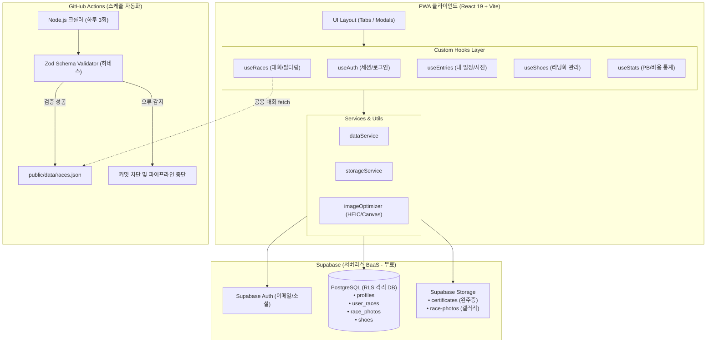

# 🏃 Maraton (마라톤 플래너 & 스케줄 하네스 PWA)

> **전국 마라톤 대회 실시간 수집 + 개인 참가 일정·목표 페이스·완주 기록·사진 갤러리·러닝화 수명 관리 올인원 PWA**  
> 모놀리식 구조를 탈피하여 **도메인별 커스텀 훅(Custom Hooks)**과 **Supabase BaaS(Auth + DB + Storage)**, **엔지니어링 하네스(Zod 데이터 안전망 + CI/CD 자동화)** 체계로 견고하게 구축되었습니다.

[](https://github.com/yongseok1991/maration-schedule/actions)
[](https://github.com/yongseok1991/maration-schedule/actions)
[](#-엔지니어링-하네스-engineering-harness)
[](LICENSE)

---

## 🏛️ 시스템 아키텍처 (Architecture)



---

## ✨ 핵심 기능 (Features)

| 탭 / 영역 | 주요 기능 설명 |
|---|---|
| **🔍 탐색 (`Browse`)** | • [로드런](http://www.roadrun.co.kr) 하루 3회 자동 크롤링 데이터 조회<br>• 지역별(전체/서울/경기 등), 월별, 접수중 필터링 및 대회명/장소/주최 통합 검색 |
| **🏅 내 일정 (`Mine`)** | • 참가 상태(관심/접수완료/준비중/완주/불참) 및 코스(5K/10K/Half/Full) 관리<br>• 목표 시간 vs 실제 완주 기록 비교, 대회 메모 및 회고<br>• **완주증 이미지(1장) + 대회 현장 사진 갤러리(최대 6장) 업로드 및 전체화면 뷰어** |
| **📅 캘린더 (`Calendar`)** | • 월별 달력에서 전체 마라톤 일정 및 내가 참가하는 대회 날짜 한눈에 확인 |
| **👟 마이페이지 (`MyPage`)** | • **PB 최고 기록 집계**: 5K, 10K, Half, Full 코스별 자동 분석<br>• **비용 통계**: 총 참가비 및 연도별 참가비 합계<br>• **러닝화 관리**: 신발별 구매가, 구매일, 누적거리(km), 용도 메모 및 연도별 신발 지출 분석<br>• JSON 데이터 백업 내보내기 / 복원 가져오기 |
| **☁️ 계정 & 클라우드 동기화** | • **게스트 모드**: 로그인 없이도 오프라인 캐시 지원<br>• **Supabase 연동**: 모든 기기 간 실시간 자동 동기화 & 고용량 사진 클라우드 보관 |

---

## 🗄️ Supabase 데이터 모델 (Database Schema)

모든 사용자 테이블은 **RLS (Row Level Security)**가 적용되어 본인의 `auth.uid() = user_id` 데이터만 안전하게 읽고 쓸 수 있습니다.

### 1. `profiles` (유저 프로필)
| 컬럼 | 타입 | 제약조건 | 설명 |
|---|---|---|---|
| `id` | `UUID` | PK, references `auth.users(id)` | 유저 고유 ID |
| `email` | `TEXT` | | 이메일 주소 |
| `nickname` | `TEXT` | | 러너 닉네임 |
| `avatar_url` | `TEXT` | | 프로필 이미지 URL |

### 2. `user_races` (사용자 참가 대회 및 기록)
| 컬럼 | 타입 | 제약조건 | 설명 |
|---|---|---|---|
| `id` | `UUID` | PK | 대회 참가 기록 ID |
| `user_id` | `UUID` | FK, references `auth.users(id)` | 작성자 유저 ID |
| `race_id` | `TEXT` | Nullable | 원본 크롤링 대회 ID (수동 등록 시 null) |
| `name` | `TEXT` | NOT NULL | 대회명 |
| `date_iso` | `DATE` | NOT NULL | 대회 일자 (`YYYY-MM-DD`) |
| `status` | `TEXT` | `interested`, `registered`, `training`, `finished`, `dns` | 대회 참가 상태 |
| `race_type` | `TEXT` | `5k`, `10k`, `half`, `full` | 코스 종목 |
| `entry_fee` | `INTEGER` | DEFAULT 0 | 참가비 (원) |
| `goal_time` / `goal_pace` | `TEXT` | | 목표 시간 및 페이스 |
| `result_time` | `TEXT` | | 실제 완주 기록 (`HH:MM:SS`) |
| `certificate_url` | `TEXT` | | Supabase Storage 완주증 이미지 CDN URL |
| `memo` / `result_note` | `TEXT` | | 훈련 메모 및 대회 후 회고 |

### 3. `race_photos` (대회 사진 갤러리)
| 컬럼 | 타입 | 제약조건 | 설명 |
|---|---|---|---|
| `id` | `UUID` | PK | 사진 ID |
| `user_race_id` | `UUID` | FK, references `user_races(id)` | 소속 대회 ID |
| `user_id` | `UUID` | FK, references `auth.users(id)` | 소유자 유저 ID |
| `photo_url` | `TEXT` | NOT NULL | Supabase Storage 사진 CDN URL |
| `display_order` | `INTEGER` | DEFAULT 0 | 정렬 순서 |

### 4. `shoes` (러닝화 관리)
| 컬럼 | 타입 | 제약조건 | 설명 |
|---|---|---|---|
| `id` | `UUID` | PK | 러닝화 ID |
| `user_id` | `UUID` | FK, references `auth.users(id)` | 소유자 유저 ID |
| `name` | `TEXT` | NOT NULL | 신발 이름 (예: 알파플라이 3) |
| `price` | `INTEGER` | DEFAULT 0 | 구매 가격 |
| `distance_km` | `NUMERIC(6,1)` | DEFAULT 0 | 누적 주행 거리 (km) |
| `purchase_date` | `DATE` | | 구매 일자 |
| `memo` | `TEXT` | | 용도 메모 (훈련용, 대회용 등) |

---

## 🧩 커스텀 훅 구조 (`src/hooks/`)

모놀리식 코드를 5개의 관심사별 커스텀 훅으로 완전 분리하였습니다:

```
src/hooks/
├── useAuth.js      # Supabase 세션 체크, 로그인/가입/로그아웃 상태 및 핸들러
├── useRaces.js     # 공용 races.json 페칭, 지역/월/접수중 필터, 검색 엔진
├── useEntries.js   # Supabase DB 연동 내 일정 CRUD, 완주증/사진 업로드 훅
├── useShoes.js     # 러닝화 목록 조회, 등록, 누적거리 수정, 삭제 훅
└── useStats.js     # 코스별 PB(5k/10k/Half/Full), 참가비 합계, 러닝화 비용 집계
```

---

## 🧪 엔지니어링 하네스 (Engineering Harness)

신뢰성 있는 개발과 데이터 파이프라인 보호를 위한 명령어 모음입니다:

```bash
# 1. 원클릭 시스템 종합 진단 (환경변수, 모듈 무결성, JSON 데이터, CI 점검)
npm run check:system

# 2. Zod 데이터 스키마 유효성 검사 (races.json 무결성 테스트)
npm run validate:data

# 3. 마라톤 일정 크롤러 실행 (하루 3회 자동 실행 스크립트)
npm run scrape

# 4. Vite 프로덕션 빌드 및 PWA 서비스워커 사전 검증
npm run build
```

---

## 🤖 Antigravity 하네스 스킬 (`maraton-harness`)

에이전트가 프로젝트 상태를 스스로 진단하고 운영할 수 있도록 전용 스킬이 등록되어 있습니다:

- **스킬 명세**: [`.gemini/skills/maraton-harness/SKILL.md`](.gemini/skills/maraton-harness/SKILL.md)
- **진단 헬퍼**: [`.gemini/skills/maraton-harness/scripts/check-system.js`](.gemini/skills/maraton-harness/scripts/check-system.js)
- 에이전트에게 *"마라톤 데이터 상태 점검해줘"* 또는 *"시스템 하네스 진단해줘"*라고 지시하면 위 스크립트들을 통해 즉시 원클릭 진단을 수행합니다.

---

## 🚀 로컬 환경 실행 가이드 (Quick Start)

### 1. 패키지 설치
```bash
npm install
```

### 2. 환경 변수 설정
`.env.example`을 복사하여 `.env.local`을 생성하고 Supabase 프로젝트 정보를 입력합니다:
```bash
cp .env.example .env.local
```

```env
# Supabase 대시보드 > Project Settings > API 에서 확인
VITE_SUPABASE_URL=https://your-project.supabase.co
VITE_SUPABASE_ANON_KEY=your-supabase-anon-key
```

### 3. 개발 서버 구동
```bash
npm run dev
```

---

## 📋 진척도 및 개발 로드맵

상세 개발 진척도와 향후 스프린트 계획은 [**TODO.md**](TODO.md)에서 실시간으로 확인하실 수 있습니다.
