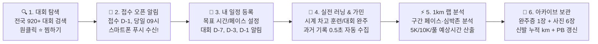

# 🏃 RACEBOOK (레이스북) — 러너를 위한 완벽 사용 설명서

> **"대회 일정 찾기부터 접수 오픈 알림, 가민 1km 랩 분석, 완주증·현장 사진 보관, 러닝화 수명 관리까지!"**  
> RACEBOOK은 마라톤을 사랑하는 모든 러너를 위해 만들어진 **올인원 마라톤 비서 & 러닝 아카이브 PWA 웹앱**입니다.  
> 별도의 앱스토어 설치 없이, 스마트폰과 PC 어디서나 브라우저 하나로 앱처럼 편리하게 이용할 수 있습니다.

[](https://yongseok1991.github.io/maration-schedule/)
[](#-4-마라톤-스마트-알림-접수-오픈-사수--d-day-챙김)
[](#-5-퍼포먼스-탭-가민-연동--1km-랩-심층-분석)
[](LICENSE)

---

## 📌 목차 (Table of Contents)

1. 💡 [RACEBOOK은 어떤 앱인가요?](#-1-racebook은-어떤-앱인가요)
2. 🗺️ [러너의 1년 마라톤 여정 (전체 서비스 흐름)](#-2-러너의-1년-마라톤-여정-전체-서비스-흐름)
3. 🔍 [대회 탐색 탭 (전국 마라톤 찾기 & 원클릭 찜)](#-3-대회-탐색-탭-전국-마라톤-찾기--원클릭-찜)
4. 🔔 [마라톤 스마트 알림 (접수 오픈 사수 & D-Day 챙김)](#-4-마라톤-스마트-알림-접수-오픈-사수--d-day-챙김)
5. ⚡ [퍼포먼스 탭 (가민 연동 & 1km 랩 심층 분석)](#-5-퍼포먼스-탭-가민-연동--1km-랩-심층-분석)
6. 🏅 [내 일정 탭 (참가 관리 & 완주증·사진 갤러리)](#-6-내-일정-탭-참가-관리--완주증사진-갤러리)
7. 📅 [캘린더 탭 (한눈에 보는 월별 마라톤 달력)](#-7-캘린더-탭-한눈에-보는-월별-마라톤-달력)
8. 👟 [마이페이지 탭 (코스별 PB 최고기록 & 러닝화 수명 트래커)](#-8-마이페이지-탭-코스별-pb-최고기록--러닝화-수명-트래커)
9. 📱 [스마트폰 홈 화면에 '진짜 앱'처럼 설치하는 방법 (PWA)](#-9-스마트폰-홈-화면에-진짜-앱처럼-설치하는-방법-pwa)
10. ❓ [자주 묻는 질문 (FAQ)](#-10-자주-묻는-질문-faq)
11. 💻 [개발자 & 기술 스택 안내 (For Developers)](#-11-개발자--기술-스택-안내-for-developers)

---

## 💡 1. RACEBOOK은 어떤 앱인가요?

러닝을 하다 보면 누구나 한 번쯤 겪는 고민들이 있습니다:
- *"JTBC 마라톤, 서울마라톤 접수 시작일이 언제였더라? 깜빡하고 마감돼서 못 나갔네..."*
- *"이번 주말에 나갈 만한 10K, 하프 대회가 어디 있지?"*
- *"내가 작년에 뛴 대회 기록증과 사진들이 사진첩에 흩어져서 찾기 힘드네..."*
- *"내 가민 시계로 뛴 수백 번의 러닝 기록을 코스별로, 1km 랩별로 한눈에 보고 싶다!"*
- *"지금 신는 러닝화, 총 몇 km나 뛰었지? 바꿀 때가 되었나?"*

**RACEBOOK은 이 모든 고민을 단 하나의 화면에서 해결해 주는 러너의 필수 러닝 파트너입니다.**

---

## 🗺️ 2. 러너의 1년 마라톤 여정 (전체 서비스 흐름)

RACEBOOK은 러너가 대회를 발견하는 첫 순간부터 완주 후 추억을 보관하는 마지막 순간까지 전 과정을 함께합니다.



---

## 🔍 3. 대회 탐색 탭 (전국 마라톤 찾기 & 원클릭 찜)

전국에서 열리는 **2025년 ~ 2027년 마라톤 대회 925건**이 실시간으로 업데이트됩니다.


### 📌 주요 사용법
1. **자유로운 통합 검색**:
   - 검색창에 가고 싶은 대회나 지역, 종목을 적어보세요.
   - `jtbc서울`처럼 **띄어쓰기를 하지 않아도**, 영문 소문자(`jtbc`)로 적어도 정확하게 찾아냅니다.
   - 대회명뿐만 아니라 **장소(여의도, 상암), 주최사, 종목(10k, 하프, 풀), 대회일(2027, 11월), 접수중** 키워드까지 모두 검색됩니다.
2. **전체 기간 한눈에 보기**:
   - 상단 월 선택 바 맨 앞의 **`[전체]` 칩**을 누르면 특정 월에 갇히지 않고 1년 치 대회를 한 번에 스크롤하며 둘러볼 수 있습니다.
   - `[오늘]` 칩을 누르면 이번 달 대회로 즉시 이동합니다.
3. **원클릭 ⭐ 관심 대회 찜하기**:
   - 대회 카드의 **별표(☆) 버튼**을 누르면 `⭐ 관심 대회`로 찜 등록됩니다.
   - 찜해둔 대회는 상단 `[⭐ 찜한 대회]` 필터 버튼으로 내가 관심 있는 대회만 모아서 볼 수 있습니다.
   - **가장 큰 장점**: 관심 등록해 둔 대회는 **접수 시작일 전날과 당일 아침 9시에 스마트폰으로 알림**을 보내드립니다!
4. **내 일정 추가 (`+` 버튼)**:
   - 출전이 확정된 대회는 **`+` 버튼**을 눌러 내 일정으로 바로 등록하세요.

---

## 🔔 4. 마라톤 스마트 알림 (접수 오픈 사수 & D-Day 챙김)

선착순 마감으로 유명한 JTBC, 동아, 춘천 마라톤 등 인기 대회를 놓치지 않도록 스마트폰과 PC로 알림을 드립니다.

### 📌 2대 핵심 알림 시스템
| 알림 종류 | 발송 타이밍 | 알림 내용 |
|---|---|---|
| ⭐ **관심 대회 접수 시작 알림** | **접수 시작 1일 전 (D-1)**<br>**접수 시작 당일 (D-Day)**<br>오전 09:00 정각 | *"내일 접수가 시작됩니다! 미리 로그인해 두세요."*<br>*"오늘 접수 오픈 당일입니다! 서둘러 신청하세요 🏃"* |
| 🏃 **출전 대회 D-Day 알림** | **대회 7일 전 (D-7)**<br>**대회 3일 전 (D-3)**<br>**대회 1일 전 (D-1)**<br>오전 09:00 정각 | *"대회가 일주일 남았습니다! 컨디션을 조절하세요."*<br>*"대회 3일 전! 탄수화물 로딩 및 테이퍼링 시작!"*<br>*"내일이 대회 당일입니다! 배번호와 신발을 챙기세요!"* |

### 📌 알림 켜는 방법 (초간단 10초)
1. 하단 메뉴에서 **[마이]** 탭으로 이동합니다.
2. 상단에 있는 **`마라톤 스마트 알림`** 카드를 찾습니다.
3. **`[스마트 알림 켜기 🔔]`** 버튼을 누르고, 브라우저에서 *"알림을 허용하시겠습니까?"*라는 팝업이 뜨면 **[허용]**을 누르면 완료!
4. 바로 아래 **`[테스트 알림 받기]`** 버튼을 눌러 내 폰이나 PC로 알림이 잘 도착하는지 바로 확인해보실 수 있습니다.

> 💡 **참고**: 앱을 켜두지 않아도, 화면이 꺼져 있어도 백그라운드로 소리와 진동 알림이 도착합니다.

---

## ⚡ 5. 퍼포먼스 탭 (가민 연동 & 1km 랩 심층 분석)

가민(Garmin) 스마트워치를 차고 달리는 러너라면 필수! 과거의 모든 러닝 기록을 0.5초 만에 불러와 정밀 분석해 드립니다.

### 📌 주요 분석 기능
1. **1회 연동 & 초고속 동기화**:
   - 가민 이메일과 비밀번호로 최초 1회만 연동하면 끝!
   - 비밀번호는 저장되지 않고 **보안 인증 토큰으로 영구 보관**되어, 매번 비밀번호를 칠 필요 없이 언제든 0.5초 만에 최신 러닝을 불러옵니다.
2. **1km 랩 스플릿(Lap Split) 정밀 차트**:
   - 각 러닝 활동을 누르면, **1km 구간마다 몇 분 몇 초 페이스로 뛰었는지 막대 차트**로 보여줍니다.
   - 구간별 평균 심박수, 케이던스, 상승 고도까지 완벽히 분석합니다.
3. **스플릿 페이스 유형 자동 판별**:
   - **Negative Split (네거티브)**: 후반부로 갈수록 페이스를 끌어올린 완벽한 빌드업 러닝!
   - **Even Split (이븐)**: 처음부터 끝까지 일정한 속도를 유지한 안정적인 러닝!
   - **Positive Split (포지티브)**: 초반 오버페이스 후 후반에 페이스가 떨어진 러닝.
4. **AI 스마트 코칭 리포트**:
   - **일관성 점수 (Consistency Score)**: 페이스 흔들림 없이 얼마나 고르게 뛰었는지 100점 만점으로 평가.
   - **에어로빅 효율성 (Aerobic EF)**: 심박수 1회당 뽑아낸 속도 효율을 분석하여 심폐 능력이 향상되었는지 확인.
5. **마라톤 완주 시간 예측기 (Race Time Predictor)**:
   - 내 실제 훈련 페이스와 심폐 데이터를 기반으로 **5K, 10K, 하프, 풀코스 마라톤 완주 예상 시간**을 자동으로 계산해 드립니다.

---

## 🏅 6. 내 일정 탭 (참가 관리 & 완주증·사진 갤러리)

내가 접수한 대회의 모든 여정을 기록하고, 현장의 감동을 고화질 사진으로 영구 소장하세요.

### 📌 주요 사용법
1. **5단계 상태 관리**:
   - `관심(⭐)` ➔ `접수완료` ➔ `준비중` ➔ `완주` ➔ `불참(DNS)` 중 현재 상태를 선택하여 일정을 체계적으로 정리할 수 있습니다.
2. **목표 시간 vs 실제 완주 기록 비교**:
   - 출전 전 적어둔 **목표 페이스**와 대회 당일 전광판에 찍힌 **실제 완주 기록**을 나란히 비교해 보세요.
3. **완주증 1장 클라우드 보관**:
   - 종이나 모바일로 받은 소중한 완주증 이미지를 등록해 두면 평생 분실 염려 없이 보관됩니다.
4. **대회 현장 사진 갤러리 (최대 6장)**:
   - 출발선, 주로(달리는 모습), 결승점 메달 사진을 최대 6장까지 업로드하세요.
   - 사진을 누르면 **고화질 전체화면 라이트박스 뷰어**로 시원하게 확대해 볼 수 있습니다.
   - *아이폰의 HEIC 사진도 자동으로 변환되어 깨짐 없이 업로드됩니다.*
5. **대회 회고 & 전략 메모**:
   - 주로의 언덕 코스 정보, 급수대 팁, 보급품 전략, 완주 후 느낀 점을 꼼꼼히 기록해 둘 수 있습니다.

---

## 📅 7. 캘린더 탭 (한눈에 보는 월별 마라톤 달력)

월별 달력 형식으로 전국 마라톤 일정과 내 출전 계획을 한눈에 조망합니다.

### 📌 주요 기능
1. **직관적인 컬러 뱃지**:
   - 달력의 각 날짜마다 전국 마라톤 대회와 내가 참가하는 대회가 컬러풀한 뱃지로 표시됩니다.
2. **날짜 클릭 상세 팝업**:
   - 궁금한 날짜를 클릭하면 해당 날짜에 열리는 **전국 대회 목록**과 **내 출전 정보**가 하단에 상세히 펼쳐집니다.
3. **이전/다음 달 넘기기**:
   - 좌우 화살표를 눌러 다가오는 봄/가을 마라톤 시즌 일정을 미리 확인하고 계획을 세우세요.

---

## 👟 8. 마이페이지 탭 (코스별 PB 최고기록 & 러닝화 수명 트래커)

내 러닝 인생의 마일스톤과 소중한 장비들을 한자리에서 관리합니다.

### 📌 1. PB (Personal Best) 명예의 전당
- 완주 기록을 입력하면 시스템이 코스별 최고 기록을 자동으로 감지합니다:
  - 🥇 **5K PB** (5km 최고 기록)
  - 🥇 **10K PB** (10km 최고 기록)
  - 🥇 **하프 PB** (21.0975km 최고 기록)
  - 🥇 **풀코스 PB** (42.195km 서브3 / 서브4 달성 기록)

### 📌 2. 러닝화 수명 관리 (신발 마일리지 트래커)
- 러닝화는 500~800km를 달리면 쿠션 수명이 다해 무릎과 관절 부상 위험이 높아집니다.
- 내가 가진 신발(예: 알파플라이 3, 베이퍼플라이, 엔돌핀 프로 등)의 **구매가, 구매일, 누적 주행 거리(km), 용도 메모(대회용/조깅용)**를 기록해 두세요.
- 누적 주행거리를 보며 러닝화 교체 타이밍을 현명하게 결정할 수 있습니다.

### 📌 3. 마라톤 가계부 (지출 통계)
- 내가 낸 마라톤 대회 총 참가비와 신발 구매 비용을 연도별로 투명하게 집계해 보여줍니다.

### 📌 4. 안전한 원클릭 데이터 백업 & 복원
- `[백업 내보내기]` 버튼 하나로 내 모든 일정과 기록을 JSON 파일로 내 컴퓨터/스마트폰에 저장할 수 있습니다.
- 기기를 바꾸더라도 `[백업 가져오기]`로 언제든 복원할 수 있습니다.

---

## 📱 9. 스마트폰 홈 화면에 '진짜 앱'처럼 설치하는 방법 (PWA)

RACEBOOK은 웹 표준 기술(PWA)로 제작되어, 앱스토어에서 번거롭게 다운로드할 필요 없이 **웹 브라우저에서 바로 스마트폰 바탕화면에 앱 아이콘으로 설치**할 수 있습니다.

### 🍎 아이폰 / 아이패드 (iOS Safari)
1. **Safari 브라우저**로 RACEBOOK 사이트에 접속합니다.
2. 화면 하단 중앙의 **공유 버튼(네모 위에 화살표 아이콘 ↑)**을 누릅니다.
3. 메뉴를 아래로 내려 **`[홈 화면에 추가]`**를 선택합니다.
4. 우측 상단의 **`[추가]`**를 누르면 끝! 이제 바탕화면에서 앱처럼 실행할 수 있습니다.

### 🤖 갤럭시 / 안드로이드 (Android Chrome)
1. **Chrome 브라우저**로 RACEBOOK 사이트에 접속합니다.
2. 화면 우측 상단의 **더보기 버튼(점 3개 ⋮)**을 누릅니다.
3. **`[홈 화면에 추가]`** 또는 **`[앱 설치]`**를 누르면 끝!

> ✨ **설치 후 장점**: 주소창 없이 전체화면으로 시원하게 구동되며, 인터넷 연결이 불안정해도 캐시를 통해 초고속으로 열립니다.

---

## ❓ 10. 자주 묻는 질문 (FAQ)

**Q1. 회원가입 없이도 이용할 수 있나요?**  
네! 로그인하지 않아도 전국 대회 탐색, 검색, 캘린더 보기는 자유롭게 이용하실 수 있습니다. 다만, 스마트 알림 수신, 사진 갤러리 업로드, 가민 연동, 기기 간 실시간 동기화를 이용하시려면 간편 로그인을 권장합니다.

**Q2. 가민 비밀번호가 사이트 서버에 저장되나요?**  
절대로 저장되지 않습니다! 가민 공식 로그인 인증을 거쳐 발급되는 보안 세션 토큰 형태로만 안전하게 보관되어, 외부 유출이나 보안 위험 없이 안전하게 보호됩니다.

**Q3. 알림이 안 와요. 어떻게 해야 하나요?**  
1. 브라우저 주소창 좌측의 설정/자물쇠 아이콘을 눌러 **[알림]**이 '허용'되어 있는지 확인해 주세요.
2. 스마트폰 자체 설정(설정 ➔ 앱 ➔ Chrome/Safari ➔ 알림)에서 알림이 켜져 있는지 확인해 주세요.
3. 마이 페이지에서 **`[테스트 알림 받기]`**를 눌러 즉시 알림이 뜨는지 테스트해 보세요.

**Q4. 비용이 드는 유료 서비스인가요?**  
아닙니다! RACEBOOK의 모든 기능은 러너들을 위해 **100% 무료**로 제공됩니다.

---

## 💻 11. 개발자 & 기술 스택 안내 (For Developers)

RACEBOOK은 최신 모던 웹 표준 기술로 설계되었습니다:

- **Frontend**: React 19, Vite, Tailwind CSS, Workbox PWA Service Worker
- **BaaS & DB**: Supabase (PostgreSQL with Row Level Security, Storage CDN, Auth)
- **External Integration**: Garmin Connect SSO Session Tokenstore, W3C Web Push (VAPID)
- **Automated Pipelines**: GitHub Actions (마라톤 크롤러 하루 3회, 스마트 알림 매일 09시 KST, 가민 자동 동기화)

### 로컬 실행
```bash
git clone https://github.com/yongseok1991/maration-schedule.git
cd maration-schedule
npm install
npm run dev
```

---

## 📄 라이선스 (License)

본 프로젝트는 [MIT License](LICENSE)를 따릅니다.  
전국의 모든 러너들의 부상 없는 즐거운 달리기(즐런)와 새로운 PB 달성을 응원합니다! 🏃‍♂️💨
