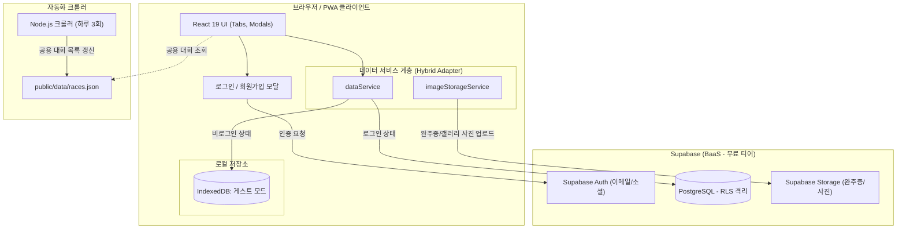

# Maraton 시스템 아키텍처 및 유저 기반 DB 연동 설계서

## 1. 시스템 개요 및 구성도

기존의 "로컬 IndexedDB + GitHub PAT 수동 동기화" 방식에서 **"게스트 오프라인 지원 + Supabase 클라우드 동기화"** 체계로 고도화합니다.



---

## 2. 프론트엔드 디렉터리 리팩터링 구조

1,239줄의 모놀리식 `App.jsx`를 관심사별로 깔끔하게 분리합니다.

```
src/
├── components/
│   ├── auth/
│   │   ├── AuthModal.jsx        # 로그인/회원가입/비밀번호 찾기 모달
│   │   └── UserProfileButton.jsx# 헤더 유저 프로필 및 로그인 트리거 버튼
│   ├── tabs/
│   │   ├── BrowseTab.jsx        # 대회 일정 탐색 및 검색
│   │   ├── MineTab.jsx          # 내 참가 일정, 목표 및 실기록
│   │   ├── CalendarTab.jsx      # 월별 대회 캘린더 뷰
│   │   ├── MyPageTab.jsx        # 통계(PB, 참가비), 러닝화 관리, 백업
│   │   └── SyncTab.jsx          # 클라우드 동기화 상태 및 계정 관리
│   ├── modals/
│   │   ├── RaceDetailModal.jsx  # 대회 상세 정보 & 내 일정 추가 모달
│   │   ├── ManualRaceModal.jsx  # 수동 대회 등록 모달
│   │   ├── ShoeModal.jsx        # 러닝화 등록/수정 모달
│   │   └── PhotoViewerModal.jsx # 대회 사진/완주증 풀스크린 뷰어
│   └── common/
│       ├── Header.jsx
│       └── Navigation.jsx
├── services/
│   ├── supabase.js             # Supabase 클라이언트 싱글톤 인스턴스
│   ├── authService.js          # 로그인, 회원가입, 세션 체크, 로그아웃
│   ├── dataService.js          # 하이브리드(IndexedDB ↔ Supabase) CRUD 통합 어댑터
│   └── imageStorageService.js  # HEIC 변환, 압축 및 Supabase Storage 업로드
├── hooks/
│   ├── useAuth.js              # 현재 로그인 세션 및 유저 상태 훅
│   ├── useRaces.js             # 공용 races.json 페칭 및 필터링 훅
│   ├── useEntries.js           # 사용자 대회 등록/수정/삭제 훅
│   └── useShoes.js             # 러닝화 관리 훅
└── utils/
    ├── dateUtils.js            # 날짜 포맷, D-Day 계산
    ├── paceUtils.js            # 페이스 및 시간 변환/계산
    └── imageOptimizer.js       # 캔버스 기반 클라이언트 이미지 리사이징
```

---

## 3. 핵심 데이터 흐름 및 UX 시나리오

### 시나리오 A: 신규 방문자 (비로그인 게스트 모드)
1. 사용자가 앱에 접속하면 로그인 없이 즉시 마라톤 일정을 둘러보고 "내 일정에 추가"할 수 있습니다.
2. 데이터는 로컬 `IndexedDB`에 안전하게 저장됩니다 (기존 앱의 장점 100% 유지).
3. 헤더 우측에 `로그인 / 동기화` 버튼이 표시됩니다.

### 시나리오 B: 회원가입 및 기존 데이터 마이그레이션 (원클릭 클라우드 전환)
1. 사용자가 `로그인 / 동기화`를 누르고 이메일 또는 소셜(구글 등)로 가입/로그인합니다.
2. 로그인이 완료되면 `dataService`가 로컬 IndexedDB에 기존 저장된 대회(`entries`)나 러닝화(`shoes`)가 있는지 확인합니다.
3. 데이터가 존재하면 안내 모달을 띄웁니다:
   > *"현재 기기에 저장된 3개의 대회 일정과 2켤레의 러닝화 기록이 있습니다. 계정으로 안전하게 동기화하시겠습니까?"*
4. 사용자가 승인하면 백그라운드에서 Supabase `user_races`, `shoes` 테이블로 일괄 업로드(Bulk Insert)하고 로컬 데이터를 클라우드 데이터와 병합합니다.

### 시나리오 C: 이미지(완주증 / 대회 사진) 저장 개선
- **기존 방식**: Base64 문자열을 IndexedDB에 저장하거나 GitHub JSON에 18MB씩 밀어넣어 브라우저 용량 부족 위험 발생.
- **개선 방식**:
  1. 클라이언트에서 먼저 기존의 `imageOptimizer.js`로 HEIC 변환 및 용량 최적화 (500KB~800KB 수준).
  2. 비로그인 시: IndexedDB에 Blob 형태로 임시 보관.
  3. 로그인 상태: Supabase Storage (`certificates/유저ID/파일명`, `race-photos/유저ID/파일명`)로 업로드 후, 반환된 **CDN 이미지 URL만 DB 컬럼에 저장**.
  4. 결과: DB 용량과 네트워크 전송량이 극적으로 절약되고 로딩 속도 대폭 개선.

---

## 4. 환경 변수 구성 (.env)

GitHub Pages 배포 시 GitHub Repository Secrets로 관리합니다.

```env
# Supabase 환경 변수 (공개용 Anon 키)
VITE_SUPABASE_URL=https://your-project-id.supabase.co
VITE_SUPABASE_ANON_KEY=eyJhbGciOiJIUzI1NiIsInR5cCI6IkpXVCJ9...
```
*(Supabase의 Anon Key는 클라이언트 공개용 키이며, RLS 정책이 걸려있으므로 브라우저에 노출되어도 완벽히 안전합니다.)*
